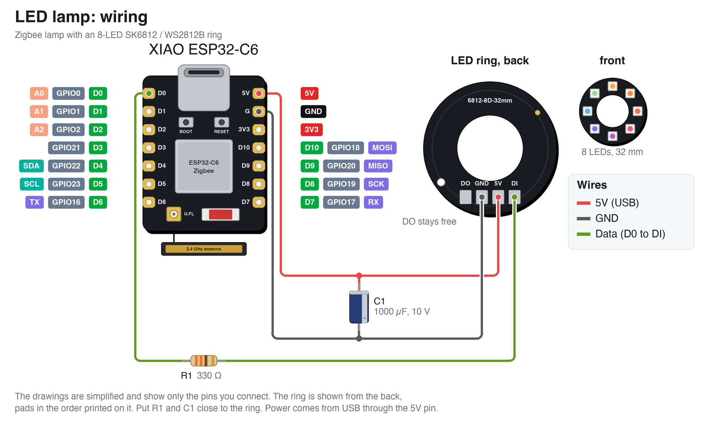

# Zigbee LED ring lamp

[](https://github.com/gaborgoncz/zigbee-led-ring-lamp/actions/workflows/compile.yml)
[](https://buymeacoffee.com/gaborgoncz)

A small colour lamp built on the **Seeed Studio XIAO ESP32-C6** and a ring of **8 WS2812B LEDs**. It joins **Zigbee** as an ordinary colour light, so Home Assistant controls it through Zigbee2MQTT like any bought bulb: on/off, brightness, colour and colour temperature.

It runs from USB and never sleeps, which makes it a **Zigbee router** as well: it passes on messages for battery devices nearby.

> **Status:** the firmware compiles (arduino-esp32 3.3.11) and is compiled on every push. It has not been run on hardware yet.

## Features

- Colour (xy and hue/saturation), colour temperature 2000–6500 K, brightness
- Smooth fades on every change, including the transitions Home Assistant sends
- **Power-on behaviour** set from Home Assistant: off, on, toggle or previous state (default previous)
- The light comes back on straight away after a power cut, without waiting for the network
- Works as a **Zigbee router**
- **BOOT** button: short press switches the lamp on or off, hold 5 s to leave the network
- Full brightness of the LEDs, with an optional current limit for weak USB ports
- Identify from Zigbee2MQTT makes the ring blink
- While it has no network, one LED breathes blue when the lamp is off

## What shows up in Home Assistant

| Entity | Kind | Notes |
|---|---|---|
| Light | light | on/off, brightness, colour, colour temperature 2000–6500 K |
| Power-on behavior | select | `off`, `on`, `toggle`, `previous` |
| Identify | button | blinks the ring for a few seconds |

## Parts

- Seeed Studio XIAO ESP32-C6
- 8-LED ring, 32 mm across with a 16 mm hole (SK6812 LEDs, WS2812B compatible, 5 V). The one used here is marked `6812-8D-32mm` on the back and has four solder pads in a row: **DO, GND, 5V, DI**
- 330 Ω resistor in the data line
- 1000 µF electrolytic capacitor, 6.3 V or more, across the ring's 5V and GND
- USB-C power supply, 5 V 1 A is plenty

## Wiring



| XIAO ESP32-C6 | Connects to |
|---|---|
| 5V | Ring 5V pad, capacitor + |
| GND | Ring GND pad, capacitor − |
| D0 | 330 Ω resistor, other end to ring DI |

Notes:

- The ring is drawn from the back, with its pads in the order printed on it. Rings from other sellers may order them differently: follow the names printed on your own board and ring. The wiring picture is drawn by [`docs/make_wiring.py`](docs/make_wiring.py).
- DO of the ring stays free. It is where a second ring would chain on. Data only flows from DI to DO, so a ring wired to DO stays dark.
- The ring runs from 5 V while the XIAO's data pin is 3.3 V. That is just below what the WS2812B datasheet asks for, and works with almost every ring on a short wire. If the LEDs flicker or show wrong colours, add a 74AHCT125 level shifter in the data line.
- At full white the 8 LEDs could draw up to about 480 mA. Use a 5 V 1 A supply; to run from a weak USB port, lower `MAX_CURRENT_MA` and the firmware dims the whole ring to stay below it.

## Flashing

Requires the Arduino IDE or `arduino-cli` with the **esp32** board package 3.3 or newer, plus the library *Adafruit NeoPixel*.

Board settings:

| Setting | Value |
|---|---|
| Board | XIAO_ESP32C6 |
| Zigbee mode | Zigbee ZCZR (coordinator/router) |
| Partition scheme | Zigbee ZCZR 4MB with spiffs |
| Erase all flash before upload | Enabled, first upload only |

With `arduino-cli`:

```bash
arduino-cli compile --fqbn "esp32:esp32:XIAO_ESP32C6:PartitionScheme=zigbee_zczr,ZigbeeMode=zczr" xiao_c6_lamp
```

```bash
arduino-cli upload --fqbn "esp32:esp32:XIAO_ESP32C6:PartitionScheme=zigbee_zczr,ZigbeeMode=zczr" -p <port> xiao_c6_lamp
```

## Zigbee2MQTT setup

1. In the Zigbee2MQTT UI open **Settings → Dev console → External converters**.
2. Create `xiao_c6_lamp.mjs` and paste the contents of [`z2m/xiao_c6_lamp.mjs`](z2m/xiao_c6_lamp.mjs).
3. Save and restart Zigbee2MQTT.
4. Enable **Permit join**, then power the lamp.

A new lamp lights up warm white at half brightness and joins the first network that permits it. To pair it again somewhere else, hold **BOOT** for 5 seconds: the ring flashes red three times, the board restarts and looks for a network.

## Configuration in the sketch

The values at the top of [`xiao_c6_lamp.ino`](xiao_c6_lamp/xiao_c6_lamp.ino):

| Define | Default | Purpose |
|---|---|---|
| `DEBUG_LOG` | `0` | Set to `1` for USB serial logging |
| `USE_EXTERNAL_ANTENNA` | `0` | `1` uses the U.FL connector instead of the on-board antenna |
| `LED_PIN` | `D0` | Data pin of the ring |
| `LED_COUNT` | `8` | LEDs on the ring |
| `MAX_CURRENT_MA` | `500` | The ring is dimmed as a whole to stay below this. Full white needs about 480 mA, so 500 never dims it; lower it for a weak USB port |
| `WHITE_BALANCE_R/G/B` | `1.0` | Scale a colour down if white looks tinted |
| `FADE_MS` | `400` | Time for every change |
| `DEFAULT_LEVEL`, `DEFAULT_MIREDS` | `127`, `370` | Light of a brand new lamp: half brightness, 2700 K |

## How it works

The Zigbee stack runs on its own task and changes the light through callbacks. They only store the wanted state; `loop()` fades the ring towards it every 10 ms, so a change from Home Assistant, the button or a transition is always smooth. Brightness is faded in perceived steps and corrected for the LEDs with a gamma of 2.2, so the low end of the slider is usable.

The WS2812B has no white LED, so colour temperature is mixed from red, green and blue along the black body curve. Full white on most rings is bluish; `WHITE_BALANCE_*` corrects that.

The light is saved to flash 5 seconds after it last changed, so a dimmer being dragged does not wear out the flash. At power-on the lamp reads it back and lights up before Zigbee has even started, then hands the same state to the stack so Zigbee2MQTT sees it. The power-on behaviour is the standard ZCL `StartUpOnOff` attribute, which Zigbee2MQTT writes directly; the firmware checks it once a second and saves it when it changes.

### Zigbee endpoint

| Endpoint | Content |
|---|---|
| 10 | Colour dimmable light: On/Off (with StartUpOnOff), Level Control, Color Control (xy, hue/saturation, colour temperature), Identify |

## Things to know

- **It is a router:** once it joins, battery devices nearby may attach to it instead of the coordinator. Leave it plugged in; a router that loses power makes its children search for a new parent.
- **Low levels:** with 8-bit LEDs the lowest brightness steps cannot all be different. At level 1 the lamp shows the faintest light the strongest colour can make.

## Support

If this project is useful to you, you can [buy me a coffee](https://buymeacoffee.com/gaborgoncz).
